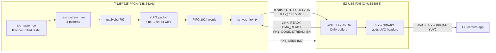

# Ti125F225 + EZ-USB FX5: FPGA test patterns as a USB 3 UVC camera

This project turns the **Efinix Titanium Ti125F225 Development Board (Rev B1)** into a plug-and-play
**USB 3 webcam**. The FPGA generates 1080p video test patterns and sends them over an 8-lane LVDS
link to the board's **Infineon EZ-USB™ FX5 (CYUSB3083)** USB controller. The FX5 presents them to
the PC as a standard **USB Video Class (UVC)** camera, so no driver is needed. Any camera app
(Windows Camera, VLC, OBS, ffplay, …) shows the stream.

- **Video:** 1920×1080 YUY2 at 30 fps (about 1.0 Gb/s) over USB 3.2 Gen 1 (5 Gb/s)
- **Patterns:** 8 test patterns, including a moving one, selected live with a push button
- **FPGA ↔ FX5 link:** GPIF III LVDS, port 0, 8 data lanes + control + clock, 8:1 at 148.5 MHz
  (1.188 Gb/s per lane)
- **Firmware:** a ready-to-flash FX5 image is included, so you don't need an IDE or the Infineon SDK
  to try it
- **Status:** working on hardware. A clean 1080p30 stream was measured at 30.0 fps with no dropped
  frames (ffmpeg, 301 frames in 10 s).


---

## Contents

1. [What you need](#what-you-need)
2. [Repository layout](#repository-layout)
3. [Board setup](#1-board-setup)
4. [Build and program the FPGA](#2-build-and-program-the-fpga)
5. [Install EZ-USB FX Control Center](#3-install-ez-usb-fx-control-center)
6. [Program the FX5 firmware](#4-program-the-fx5-firmware)
7. [Run it](#5-run-it)
8. [Buttons and LEDs](#buttons-and-leds)
9. [Troubleshooting](#troubleshooting)
10. [How it works](#how-it-works)
11. [Rebuilding the FX5 firmware (optional)](#rebuilding-the-fx5-firmware-optional)
12. [Simulation](#simulation)
13. [Credits and licenses](#credits-and-licenses)

---

## What you need

| Item | Notes |
|---|---|
| Efinix **Ti125F225 Development Board, Rev B1** | Has the FX5 (CYUSB3083) on board, wired to the FPGA's LVDS bank |
| **Efinity** software | Built with Efinity 2026.1. Includes Interface Designer and the Programmer |
| Windows PC with a **USB 3 port** | 5 Gb/s or faster. Plug in directly, **not through a hub** |
| **USB-C cable rated for USB 3** data (5 Gb/s or faster) | Many USB-C cables are USB 2.0-only or charge-only, and the stream won't work through them |
| Infineon **EZ-USB FX Control Center** | Free Windows tool, used once to flash the FX5 |
| 2 jumpers | For the board jumper settings below |

---

## Repository layout

| Path | What it is |
|---|---|
| `ti125_fx5_uvc.xml` | Efinity project |
| `ti125_fx5_uvc.isf` | Interface Designer settings: I/O banks, PLL, 10 LVDS TX blocks, buttons, LEDs, FX5 control pins |
| `constraints/ti125_fx5_uvc.sdc` | Timing constraints |
| `rtl/ti125_fx5_uvc_top.sv` | Top level: reset and FX5 reset sequencing, pattern path, link |
| `rtl/fx_lvds_link_tx.v` | FX5 LVDS link layer: PHY/link training, addressing, DATA/IDLE/EOP, DMA_READY flow control |
| `rtl/tpg_raster_ce.sv` | Flow-controlled raster generator, the video timing source for the USB path |
| `rtl/ycbcr_to_yuy2_packer.sv` | Packs 4 pixels of YUY2 into one 8-lane, 64-bit word |
| `rtl/sync_fifo_fwft.v`, `rtl/sync2.v` | FIFO and synchronizer |
| `rtl/hdmi_tp/` | Test pattern generator and RGB→YCbCr (BT.709) from the original HDMI test pattern design |
| `hdmi_tp_ref/` | The original HDMI test pattern project files, for reference |
| `fx5_firmware/ti125_fx5_uvc_fw.hex` | **Ready-to-flash FX5 firmware** (signed for the FX5 USB bootloader) |
| `fx5_firmware/FLASHING.md` | Short flashing and troubleshooting guide |
| `fx5_firmware/source/` | FX5 firmware sources plus a stand-alone build script (no ModusToolbox needed) |
| `sim/tb_fx5_link.v` | Testbench with a behavioral FX5 LVDS receiver / DMA model |
| `docs/` | Images |

---

## 1. Board setup

Set these jumpers on the Ti125F225 board before powering up:

| Jumper | Setting | Why |
|---|---|---|
| **PH13** `VCCIO4A_4B` | **1V8** | LVDS TX banks 4A/4B. The QSE2 connector's MIPI lanes share these banks, so leave QSE2 empty. |
| **PH24** `VDDIO_P0` | **3V3** | FX5 LVDS receiver supply |
| **PH7** `VCCIO33_BL` | **1V8** | FPGA BL bank and the FX5's P0 control pins |
| **PH26** `FX5_3V3_1V8` | **1-2 (1.8 V)** | FX5 I/O rail. Also the pull-up rail for FX5 reset, which the FPGA drives on a 1.8 V pin |
| **PH19** | **Installed** | Connects FPGA pin M2 to `FX5_XRES`, so the FPGA can sequence the FX5 reset |
| **PH25** | **Open** for normal use | Shorting it at power-up puts the FX5 into its USB bootloader, which is only needed for flashing |

An HDMI daughtercard on QSE1 can stay installed; this design doesn't use it.

---

## 2. Build and program the FPGA

1. Open **`ti125_fx5_uvc.xml`** in Efinity.
2. Open **Interface Designer** and use its import function to load **`ti125_fx5_uvc.isf`**. This creates the
   PLL, the 10 LVDS TX blocks, the GPIOs and the bank voltages. Save and generate, then close Interface
   Designer.
3. Run the full compile: synthesis, place & route, bitstream. Check the timing report for
   `clk_par` (148.5 MHz) and `lvds_fast_clk` (594 MHz).
4. Program the generated **`.hex`** into the board's **SPI flash** with the Efinity Programmer, as you
   would any design for this board.

> **Interface Designer notes**, in case you rebuild the I/O by hand. The 10 LVDS TX blocks use 8-bit
> serialization with **half-rate serialization enabled**, serial clock `lvds_fast_clk` (594 MHz, 90°),
> and parallel clock `clk_par` (148.5 MHz) from `PLL_BL0`, which is fed by the 74.25 MHz oscillator
> on ball P11. The clock lane `fx_clk_tx` uses **Reference clock output** mode. The
> `<block>_TX_RST` / `<block>_TX_OE` pin names must keep their defaults. The FX5 reset on **M2** is a
> bidirectional GPIO with IN/OUT/OE pins `fx5_xres_in` / `fx5_xres_out` / `fx5_xres_oe`.

---

## 3. Install EZ-USB FX Control Center

EZ-USB FX Control Center is Infineon's free Windows utility for programming EZ-USB FX5/FX10/FX20
devices over USB. It's the only Infineon tool you need to *use* this project. You don't need
ModusToolbox or the FX SDK unless you want to change the firmware.

1. **Download** EZ-USB FX Control Center from Infineon's EZ-USB FX5 product or kit page, or from the
   [EZ-USB FX product family page](https://www.infineon.com/cms/en/product/promopages/ez-usb-fx/). The
   [EZ-USB FX5 DVK kit guide](https://www.infineon.com/assets/row/public/documents/30/44/infineon-development-board-kit-fx5-fmc-001-usermanual-en.pdf)
   points to the same download. You may need a free Infineon account to sign in.
2. **Run the installer** with the default options. You may need administrator rights. The installer
   also sets up the USB driver that the FX5 bootloader uses.
3. **Start Control Center** once to confirm it opens. Its device list is empty until a board is
   connected.

---

## 4. Program the FX5 firmware

The firmware image is **`fx5_firmware/ti125_fx5_uvc_fw.hex`**. You only need to do this once per
board, or again after a firmware update.

1. **Power off** the board and unplug all USB cables.
2. **Put a jumper on PH25.** With PH25 shorted at power-up, the FX5 starts in its USB bootloader
   instead of running its application.
3. **Power the board** and connect the **FX5 USB-C port** to the PC.
4. Open **EZ-USB FX Control Center**. Under *Devices* the FX5 bootloader appears as
   **FX3G2 USB BL** ("FX3G2" is the FX5/FX10/FX20 silicon family name). Its descriptor shows
   VID `0x04B4`, PID `0x00E1`, and product name *FX3G2 USB BL*. **Select it.**

   

5. Choose **Program → Internal Flash**, browse to **`ti125_fx5_uvc_fw.hex`** and click **Open**.
6. Wait for the **Log** window to report that programming finished. The device then detaches.
7. **Power off the board, remove the PH25 jumper**, and power it back on.

> ⚠️ **Don't use any "update bootloader" option** in Control Center or other Infineon tools. On this
> board the FX5's SWD debug pins aren't connected, so a damaged bootloader can't be recovered.

---

## 5. Run it

1. Make sure the FPGA flash holds this design, PH25 is **open**, and the jumpers match
   [Board setup](#1-board-setup).
2. Power the board and connect the **FX5 USB-C port directly to a USB 3 port** on the PC.
3. Wait **about 4 seconds**. The FPGA configures, holds the FX5 in reset until the LVDS link is ready,
   then releases it. The FX5 trains the link and connects to USB. **USER_LED2** lights when the link
   is trained.
4. Windows finds a camera named **Ti125 FX5 UVC**. Open any camera app:
   - **Windows Camera** app: select *Ti125 FX5 UVC*.
   - **VLC:** *Media → Open Capture Device*, then pick the device.
   - **ffplay:** `ffplay -f dshow -i video="Ti125 FX5 UVC"`
5. Press **BUTTON_0** to step through the 8 patterns. **USER_LED1** blinks while frames are
   flowing.

To confirm the full frame rate:

```
ffmpeg -hide_banner -f dshow -i video="Ti125 FX5 UVC" -t 10 -f null -
```

You should see about **300 frames in 10 s (30 fps)**.

> The camera is a standard UVC 1.1 device, so it should also work on Linux (`guvcview`,
> `ffplay -f v4l2 /dev/videoN`) and macOS. It has only been tested on Windows.

---

## Buttons and LEDs

| Control | Function |
|---|---|
| **BUTTON_0** | Next test pattern (0 → 7 → 0). The change takes effect at the next frame |
| **BUTTON_2** | **System reset**: resets the FPGA logic *and* the FX5 (via `FX5_XRES`). The camera disconnects and reconnects |
| **BTN4** (board) | FX5 reset button. Not needed in normal use |
| **USER_LED1** | Heartbeat: toggles every 32 frames sent, so it blinks about once a second at 30 fps |
| **USER_LED2** | LVDS link trained |
| **USER_LED3** | Link protocol error, latched until reset. It should stay off |
| **USER_LED4–6** | Current pattern number (binary) |

---

## Troubleshooting

| Symptom | Likely cause and fix |
|---|---|
| Picture is scrambled into fine multicolored stripes and seems frozen | The USB link fell back to **USB 2.0** because of a hub, a USB 2 / charge-only cable, or a USB 2 port. On USB 2 the device only offers a 640×480 fallback format. Connect directly to a USB 3 port with a USB 3 cable. To check, `ffmpeg -hide_banner -f dshow -list_options true -i video="Ti125 FX5 UVC"` must list **`s=1920x1080`** |
| Control Center doesn't show **FX3G2 USB BL** | Check that PH25 is shorted **before** power-up. Try another cable or port, and look in Device Manager for an unknown device |
| No camera appears at all | Check that PH25 is **open** and that the FX5 was flashed. The firmware connects to USB even if the LVDS link fails |
| Camera appears but no picture, USER_LED2 off | The link didn't train. Check that the FPGA is programmed and the jumpers are set (especially PH13, PH24, PH7, PH19), then press BUTTON_2 |
| Camera appears but no picture, USER_LED3 on | Protocol mismatch between FPGA and firmware. `BUF_BYTES` in the FPGA top must be 61440 |
| Worked, then stopped after the FPGA was reprogrammed | Press **BUTTON_2** or power-cycle. The FX5 trains the link only at start-up |
| Plugged into a monitor's USB-C input and nothing shows | Expected. A monitor's USB-C input is a DisplayPort Alt Mode *input*, but a UVC camera needs a USB **host** (a PC) to read it |

---

## How it works



**Video path.** `tpg_raster_ce` generates active pixels only and pauses whenever the FIFO is
full. The FX5 controls the pace through DMA_READY back-pressure, so the pattern is never torn or
dropped. The pattern generator and color conversion are reused unchanged from the HDMI test
pattern design. The sync signals are reused as start-of-frame and end-of-line markers. Pixels are
converted to BT.709 YCbCr, subsampled to 4:2:2, and packed as YUY2: 4 pixels = 8 bytes = one byte
per LVDS lane per clock.

**LVDS link layer** (`fx_lvds_link_tx.v`), following Infineon's FX GPIF III LVDS protocol:

1. **Training.** When the FX5 raises LINK_READY, the FPGA sends the PHY training pattern (`0x9C`)
   on all lanes until the FX5 reports PHY training done. It then sends the link training block
   (`0x125A4B78`) and goes idle.
2. **Addressing.** At each frame start the FPGA selects thread 0 / socket 0 with STAD/SSAD control
   bytes.
3. **Data.** The FPGA sends exactly one FX5 DMA buffer (61,440 bytes) at a time. Each frame
   (4,147,200 bytes) is 67 full buffers plus one 30,720-byte buffer closed with **EOP**.
4. **Flow control.** The FX5's DMA_READY (FLAGA) is honored **on every word**. The FX5 uses it as
   live back-pressure, not only between buffers. Words are also paced at no more than one per 2
   clocks (4.75 Gb/s), which is still twice the pattern rate.

**FX5 firmware.** This is Infineon's `mtb-example-fx20-uvc-uac-4k-camera` ported to this board:

- **Part and USB:** CYUSB3083, USB 3.2 Gen 1.
- **LVDS settings:** 8:1 gearing at 148.5 MHz with hardware PHY training.
- **UVC format:** one format, 1080p30 YUY2, with the UVC headers added by the FX5.
- **Product string:** "Ti125 FX5 UVC".
- **No I2C on this board.** The reference flow configures the FPGA over I2C, and this board has no
  FX5↔FPGA I2C connection. The firmware intercepts those register writes and turns the two that
  matter into GPIOs on spare FX5 control pins:
  - **PHY_DONE** on P0CTL4
  - **STREAM_EN** on P0CTL3 (high while the PC is streaming)

  The FPGA has fixed video parameters and boots from its own SPI flash.

**Power-on sequencing.** The FPGA drives `FX5_XRES` (open drain on M2). It holds the FX5 in reset
until the PLL is locked and the link logic is ready, then releases it 10 ms later. The FX5 then
boots into a link that is ready to train, so no manual reset is needed.

---

## Rebuilding the FX5 firmware (optional)

You only need this to change the firmware. The build runs on Linux or WSL **without ModusToolbox**.
`build.py` replaces ModusToolbox's make system for this one application, and `fetch_libs.sh` downloads
the exact Infineon library versions used:

```bash
sudo apt install gcc-arm-none-eabi libnewlib-arm-none-eabi git python3-pip
pip install intelhex
cd fx5_firmware/source
./fetch_libs.sh        # pinned Infineon libraries from GitHub (usbfxstack 1.3.4, PDL 3.23, FreeRTOS 10.6)
python3 build.py       # -> build/ti125_fx5_uvc_fw.hex, compiled and signed
```

`build.py` appends the SHA-256 signature the FX5 bootloader checks, the same one
`cymcuelftool --sign` produces. Building the sources as provided reproduces the shipped `.hex`
byte for byte. The board-specific changes are marked with `TI125_FX5_BOARD` in the sources. Most
of them are in `cy_gpif_header_lvds.h`, `cy_usb_descriptors.c`, `cy_usb_i2c.c` and
`fx5_fpga_sideband.c`.

---

## Simulation

The testbench drives the FPGA top level against a behavioral FX5 model. The model covers LVDS
receive, DMA buffers, DMA_READY back-pressure, the reset pin and host stop/start. Run it with
[Icarus Verilog](https://steveicarus.github.io/iverilog/):

```bash
SRC="rtl/*.v rtl/*.sv rtl/hdmi_tp/test_pattern_gen.sv rtl/hdmi_tp/rgb2ycbcr709.sv rtl/hdmi_tp/hdmi_tp_util.sv"

# Protocol test: training, flow control, stop/restart, system reset (64x20 frames)
iverilog -g2012 -o sim/tb.vvp sim/tb_fx5_link.v $SRC && (cd sim && vvp tb.vvp)

# All 8 patterns at 320x180; writes frameN.yuv
iverilog -g2012 -o sim/tbp.vvp -P tb_fx5_link.H=320 -P tb_fx5_link.V=180 -P tb_fx5_link.BUF=15360 \
  -P tb_fx5_link.NFRAMES=9 -P tb_fx5_link.STOP_TEST=0 -P tb_fx5_link.SYSRST_TEST=0 \
  -P tb_fx5_link.CYCLE_PATTERNS=1 sim/tb_fx5_link.v $SRC && (cd sim && vvp tbp.vvp)

# View a frame
ffplay -f rawvideo -pixel_format yuyv422 -video_size 320x180 sim/frame1.yuv
```

---

## Credits and licenses

- **FPGA design** (RTL, constraints, Efinity project): this repository.
- **Test pattern generator and color conversion** (`rtl/hdmi_tp/`): from the Ti125F225 HDMI test
  pattern design.
- **FX5 firmware:** derived from Infineon's
  [`mtb-example-fx20-uvc-uac-4k-camera`](https://github.com/Infineon/mtb-example-fx20-uvc-uac-4k-camera).
  Infineon / Cypress source files keep their original copyright and license headers (Apache-2.0),
  and the example's `LICENSE` file is included in `fx5_firmware/source/app/`. The firmware runs on
  the Infineon EZ-USB FX5 and links Infineon's `usbfxstack` and PDL libraries, which
  `fetch_libs.sh` downloads separately under their own licenses.
- **Board support configuration** for the FX3G2 silicon is adapted from Tom McDermott's
  [Firmware-FX10-Quad](https://github.com/Tom-McDermott/Firmware-FX10-Quad) (TAPR license).
- EZ-USB™, ModusToolbox™ and related names are trademarks of Infineon Technologies AG. Efinix,
  Titanium and Efinity are trademarks of Efinix, Inc.
