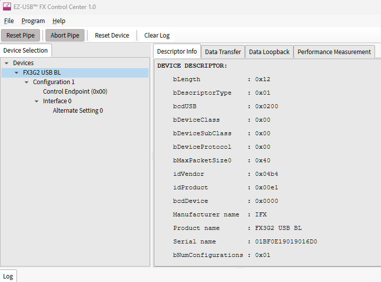

# Flashing the FX5 firmware (no IDE, no ModusToolbox)

The file to flash is **`ti125_fx5_uvc_fw.hex`** in this folder. It is already built and signed
for the FX5 USB bootloader. The only Infineon program you need is **EZ-USB FX Control Center**.

## One-time: install EZ-USB FX Control Center

1. Download it from Infineon:
   https://softwaretools.infineon.com/tools/com.ifx.tb.tool.ezusbfxcontrolcenter
   (It's a standalone tool. You don't need ModusToolbox.)
2. Install with the defaults. The installer also adds the USB driver the bootloader uses.

## Flash the FX5 (about 2 minutes)

1. **Power the board off** and unplug every USB cable.
2. **Put a jumper on PH25** (FX5 boot mode). Shorting PH25 at power-up holds the FX5 in its USB
   bootloader.
3. Power the board and connect the **FX5 USB-C port (USB2)** to the PC.
4. Open **EZ-USB FX Control Center**. Under *Devices* the bootloader appears as **FX3G2 USB BL**
   (VID 0x04B4, PID 0x00E1). Click it.

   
5. Click **Program → Internal Flash**, pick `ti125_fx5_uvc_fw.hex`, and wait for the log window
   to say programming succeeded.
6. **Remove the PH25 jumper**, then power-cycle the board (unplug and replug).

> Don't use any "update bootloader" option in Control Center or in other Infineon tools. On this
> board the FX5's SWD pins aren't connected, so there's no way to recover a broken bootloader.

## Run it

1. The FPGA must hold the `ti125_fx5_uvc` bitstream, programmed into its SPI flash with Efinity
   Programmer as usual. You can program the FPGA and the FX5 in either order.
2. Check the jumpers: PH13 = 1V8, PH24 = 3V3, PH7 = 1V8, PH25 open.
3. Power up and plug the FX5 USB-C port into a **USB 3 (5 Gb/s or faster) port**. On a USB 2
   port the camera still shows up, but 1080p video can't fit through it.
4. **Wait about 4 seconds.** With the FX5_XRES build (FPGA drives pin M2), the FPGA holds the FX5
   in reset until it's configured and ready, then releases it. The FX5 waits 3 s, trains the LVDS
   link, and then connects to USB. No BTN4 press is needed. With older FPGA builds, press BTN4
   once after power-up.
5. **USER_LED2** turns on when the link is trained. The PC then finds a camera named
   **Ti125 FX5 UVC**.
6. Open the Windows **Camera** app, VLC (*Media → Open Capture Device*) or
   `ffplay -f dshow -i video="Ti125 FX5 UVC"`. The only format offered is 1920×1080 YUY2 at
   30 fps.
7. **USER_LED1** blinks while frames flow. **BUTTON_0** steps through the 8 patterns, and
   LED4..6 show the pattern number.

## If something's off

| What you see | Try |
|---|---|
| Picture is scrambled into fine stripes and seems frozen | The link has fallen back to **USB 2.0**: usually a hub or a charge-only/USB 2 cable. Plug directly into a USB 3 port. To check, `ffmpeg -hide_banner -f dshow -list_options true -i video="Ti125 FX5 UVC"` must list `s=1920x1080`. If it only lists 640x480, the link is on USB 2. |
| Control Center doesn't list the bootloader device (*FX3G2 USB BL*) | Check that the jumper is on PH25 *before* power-up, try a different cable or port, and look in Device Manager for an unknown device. If it still doesn't appear, the FX5 has no bootloader. Ask Efinix, because this board needs SWD access to load one. |
| No camera appears at all (firmware rev 2 or later) | Check PH25 is open and the FX5 was flashed; the firmware enumerates even with a dead link. |
| Camera appears but no picture and USER_LED2 stays off | The link didn't train. Press the **FX5 reset button (BTN4)** once the FPGA is running. If LED2 still stays off, check the FPGA side: serializer bit order (`TX_LSB_FIRST`), then PLL lock. |
| Camera appears but the picture is black or frozen, and USER_LED3 is on | Protocol error. `BUF_BYTES` in the FPGA top must be 61440. |
| Camera appears, LED2 on, but the image tears or rolls | Re-check the FPGA timing report for clk_par / lvds_fast_clk. |
| The camera worked, then stopped after the FPGA was reprogrammed | Press BUTTON_2 (system reset: FPGA logic + FX5), BTN4 or power-cycle. The FX5 only trains the link at start-up. |

## What's in this firmware (for reference)

It's Infineon's `mtb-example-fx20-uvc-uac-4k-camera` with these changes for this board:

- **Part and board:** CYUSB3083-FCAXI, 24 MHz crystal, USB 3.2 Gen 1 (5 Gb/s).
- **LVDS port 0:** 8 lanes, gear ratio 8:1, 148.5 MHz clock lane (1.188 Gb/s per lane), PHY
  training byte 0x9C, link block 0x125A4B78.
- **No FX5↔FPGA I2C on this board:** every FPGA register access becomes a GPIO or a no-op (see
  `source/app/fx5_fpga_sideband.c`):
  - P0CTL4 is **PHY_DONE**, high once PHY training is finished.
  - P0CTL3 is **STREAM_EN**, high while the PC is streaming.
  - LINK_READY (P0CTL6) and DMA_READY (P0CTL5) work as in the reference design.
- **FPGA configuration:** the FX5 doesn't configure the FPGA, which boots from its own flash.
- **Descriptors:** one video format, 1920×1080 YUY2 @ 30 fps. The product string is
  "Ti125 FX5 UVC".
- **Buffers:** manual DMA with the UVC header added by the FX5. Buffers are 61472 bytes, and the
  FPGA fills 61440 bytes of each.
- **Low power:** LVDS low-power and deep-sleep modes are off.
- **Training:** hardware PHY training only (`CUSTOM_TRAIN_ENABLE=0`). PHY_DONE is raised as soon
  as the FX5 hardware reports PHY training done. Any training wait is time-limited, so the camera
  always enumerates even if the link fails (you'd then see the camera but no picture).

## Rebuilding it yourself (optional)

You only need this if you change the firmware. It runs on any Linux machine or WSL, with no
ModusToolbox:

```
sudo apt install gcc-arm-none-eabi libnewlib-arm-none-eabi git python3-pip
pip install intelhex
cd source
./fetch_libs.sh          # downloads the pinned Infineon libraries from GitHub
python3 build.py         # -> build/ti125_fx5_uvc_fw.hex (compiled and signed)
```

`build.py` replaces ModusToolbox's make system for this one app. It compiles with the same
flags and adds the SHA-256 signature the FX bootloader checks, the same signature
`cymcuelftool --sign` produces. Building these exact sources reproduces the shipped `.hex`
byte for byte.
